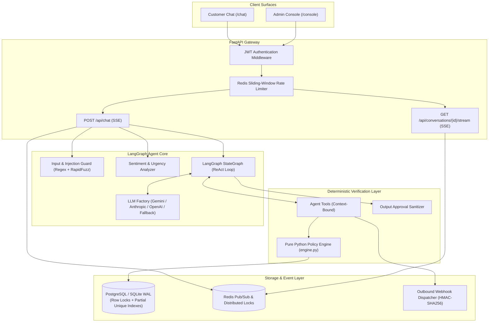

# ApexSupport AI: Autonomous Customer Support Backend with Deterministic Guardrails & Double-Verification Policy Engine

> **"The LLM proposes, the code disposes."**  
> An enterprise AI customer support backend built with **FastAPI**, **LangGraph**, **SQLAlchemy Async**, **Redis**, and a **deterministic policy engine** that makes it physically impossible to talk the model into an unauthorized refund, leak cross-tenant data, or trigger race-condition double refunds.

---

## Key Highlights & Architectural Strengths

- **Dual-Layered Deterministic Policy Engine**: LLM reasoning is strictly segregated from transaction execution. Even under extreme prompt injection, jailbreaks, or model hallucinations, refunds can **only** be committed if verified by pure deterministic Python rules (`delivery status`, `30-day window`, `final-sale status`, `order ownership`, and `$500 human escalation threshold`).
- **Race-Condition & Double-Refund Immunity**: Employs row-level database locking (`SELECT ... FOR UPDATE`) coupled with an engine-level partial unique constraint (`uq_refunds_one_approved_per_order`). Concurrent requests are serialized and safely rejected.
- **Strict Identity & Cross-Tenant Isolation**: Verified customer identity is extracted exclusively from JWT claims and injected into `ToolContext`. Customer order lookups reject foreign requests with masked 404 responses, eliminating oracle enumeration vulnerabilities.
- **Indirect Prompt Injection Defense**: Real-time heuristic and fuzzy string scanning strips instruction-like text from database fields (e.g., adversarial product or customer names) before passing tool observations back to the LLM context.
- **Customer Frustration & Sentiment Matrix**: Real-time sentiment scoring and urgency detection on every turn flags distressed customers and initiates proactive supervisor triage.
- **Outbound Webhook Dispatcher**: Asynchronously dispatches cryptographically signed (HMAC-SHA256) webhooks on state changes (`refund.approved`, `refund.denied`, `refund.escalated`) to integrate with ERPs, CRMs, or Slack.
- **Zero-Docker Dual-Database Support**: Runs locally out of the box on SQLite with WAL mode (`aiosqlite`) and in-memory `fakeredis`, or connects seamlessly to production PostgreSQL + Redis in Kubernetes / Cloud Run.
- **Multi-Provider LLM Resilience**: Built-in support for Google Gemini (`gemini-3.8-flash`), Anthropic Claude, OpenAI, and custom OpenAI-compatible proxies, featuring automatic failover and a scripted mock provider for zero-cost load testing.
- **Real-Time SSE Streaming**: Full Server-Sent Events (SSE) streaming for customer chat tokens alongside live reasoning/tool step-by-step traces for admin dashboards.

---

## Architecture Diagram



---

## LLM Agent vs. ApexSupport Guardrailed Architecture

| Feature | Standard Naive LLM Agent | ApexSupport AI Guardrailed Backend |
| :--- | :--- | :--- |
| **Financial Authority** | LLM prompt decides approvals | LLM only proposes; Python policy engine validates deterministically |
| **Prompt Injection Defense** | System prompt instructions only | Multi-layer: regex + fuzzy matching + indirect injection text scrubbing + hard DB gates |
| **Double Refund Protection** | Prone to prompt manipulation / race conditions | Guaranteed via DB row locks (`FOR UPDATE`) + partial unique constraints |
| **Customer Isolation** | Prompt-guided user IDs | Identity fixed in `ToolContext` directly from JWT claims; foreign IDs return 404 |
| **Concurrency & Flooding** | Unguarded token consumption | Per-conversation distributed turn locks + sliding-window backpressure |
| **Output Integrity** | Can hallucinate fake approvals | Sanitizer checks affirmative approval claims against actual DB tool outputs |
| **Downstream Integration** | Manual polling or external scripts | Automated HMAC-SHA256 signed asynchronous webhook dispatching |
| **Local Developer Experience** | Requires multi-container Docker setup | Zero-docker instant SQLite WAL mode with full async SQLAlchemy parity |

---

## Tech Stack

- **Backend Framework:** FastAPI, Uvicorn, SSE-Starlette, Pydantic v2, Pydantic-Settings
- **Agent & Workflow:** LangGraph, LangChain Core, Google GenAI SDK, Anthropic SDK, OpenAI SDK
- **Database & ORM:** SQLAlchemy 2.0 (Async), AsyncPG, AioSQLite, Alembic
- **Distributed State & Streaming:** Redis, FakeRedis, Server-Sent Events (SSE)
- **Security & Guardrails:** PyJWT, RapidFuzz, Regex Obfuscation Detectors, HMAC-SHA256
- **Observability:** Prometheus Client, Structured JSON Logging, Sentry, Opik Tracing
- **Testing & Verification:** Pytest, Pytest-Asyncio, Locust (load testing)

---

## Quick Start (Zero-Docker Local Development)

ApexSupport AI can run completely locally with **zero external dependencies** using SQLite with Write-Ahead Logging (WAL) and in-process FakeRedis.

### 1. Clone & Set Up Environment

```bash
cd backend
python -m venv .venv
source .venv/bin/activate  # On Windows: .\.venv\Scripts\activate
pip install -r requirements-dev.txt
```

### 2. Configure Environment Variables

```bash
cp .env.example .env
```

Set your preferred provider:
```ini
LLM_PROVIDER=gemini
GEMINI_API_KEY=your_gemini_api_key_here
```
*(No API key? Set `LLM_PROVIDER=fake` to run on the deterministic scripted model at zero cost).*

### 3. Initialize Database & Run Server

```bash
# Seed local database fixture (creates customers and test orders)
python -m app.db.seed

# Start the FastAPI server with hot-reload
uvicorn app.main:app --host 0.0.0.0 --port 8000 --reload
```

- **Interactive API Documentation (Swagger):** `http://localhost:8000/docs`
- **Health Live Endpoint:** `http://localhost:8000/api/health/live`
- **Prometheus Metrics:** `http://localhost:8000/metrics`

---

## Docker Compose Quick Start (Production-Grade Stack)

To run the complete production topology with PostgreSQL, Redis, Database Migrations, Backend, and Frontend:

```bash
# 1. Provide API key
cp .env.example .env

# 2. Build and run containers
docker compose up --build
```

- **Customer Chat Interface:** `http://localhost:3000/chat`
- **Agent Admin Console (Live Reasoning Timeline):** `http://localhost:3000/console`
- **Backend API:** `http://localhost:8000/docs`

---

## Deterministic Refund Policy Rules

1. **Final-Sale Rule:** Items marked as final sale cannot be refunded under any condition.
2. **Human Escalation Threshold:** Automated refunds cannot exceed **\$500.00**. High-value orders are automatically routed to human specialists.
3. **30-Day Delivery Window:** Items must have been delivered within the last 30 days. Orders still in transit or delivered >30 days ago are denied.
4. **Single Refund Guarantee:** An order that has already been refunded cannot receive a duplicate refund.
5. **Tenant Ownership Verification:** Order IDs must belong to the verified JWT customer. Probing other customer IDs yields masked 404 responses.

---

## Running the Test Suite

```bash
cd backend
pytest -v
```

Tests cover:
- Policy engine unit evaluation
- Prompt injection and heuristic evasion detection
- Cross-tenant data isolation
- Concurrency and row locking
- Customer sentiment scoring
- Webhook HMAC signing and delivery logging
